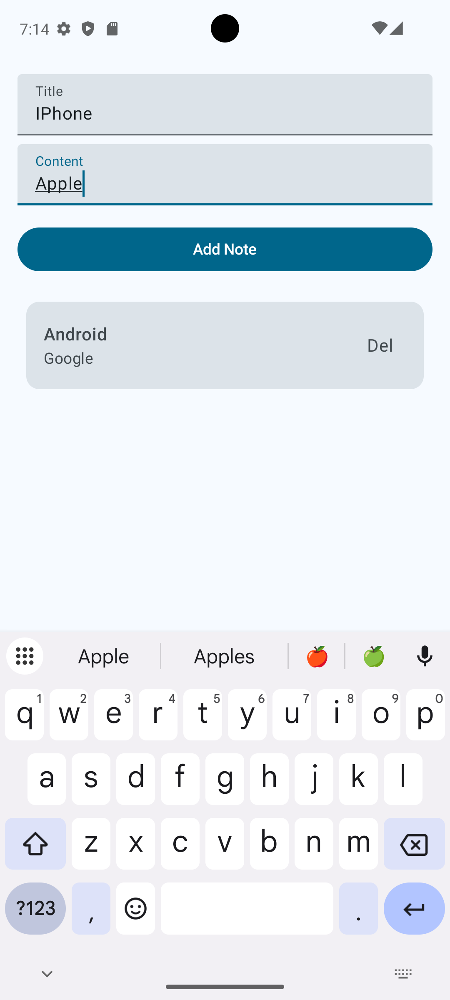
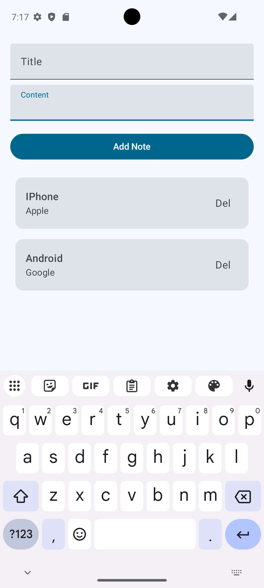
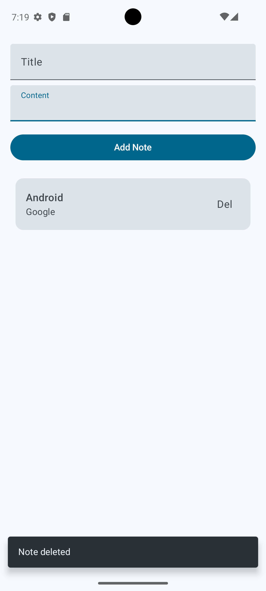

# NoteTakingApp

NoteTakingApp is a modern Android application designed for creating, viewing, and deleting personal notes. Built with Jetpack Compose, the app follows clean architecture principles and incorporates industry-standard security and dependency injection practices.

## Compatible Devices
Android 7.0 (API 24) and higher

## Supported User Interface
Mobile

## Features
- Create new notes with a title and content.
- View a list of saved notes, ordered by the most recent.
- Delete existing notes easily.
- **Offline First**: All notes are stored locally in a Room database.
- **Security**: The database is fully encrypted using SQLCipher, with hardware-backed key generation via Google Tink.

## Installation Instructions
1. Clone this repository to your local machine.
2. Open the project in Android Studio.
3. Sync the project with Gradle files.
4. Build and run the app on an emulator or a connected physical device.

## App Architecture
The app follows a modern **Clean Architecture** (MVI/MVVM) pattern to ensure separation of concerns, testability, and scalability:
- **Presentation Layer**: UI built with Jetpack Compose, state management using `StateFlow` and `ViewModel`.
- **Domain Layer**: Contains business logic encapsulated in Use Cases (`AddNote`, `DeleteNote`, `GetNotes`) and customized Exceptions (`NoteException`).
- **Data Layer**: Local storage implemented using Room Database with DAOs and Repositories.

## Used Libraries
* [Jetpack Compose](https://developer.android.com/jetpack/compose) - Android’s modern toolkit for building native UI.
* [Dagger-Hilt](https://dagger.dev/hilt/) - Dependency injection library for Android that reduces the boilerplate of doing manual dependency injection.
* [Room](https://developer.android.com/topic/libraries/architecture/room) - Provides an abstraction layer over SQLite to allow fluent database access while harnessing the full power of SQLite.
* [SQLCipher](https://www.zetetic.net/sqlcipher/) - An open-source extension to SQLite that provides transparent 256-bit AES encryption of database files.
* [Google Tink](https://developers.google.com/tink) - A multi-language, cross-platform, open-source library that provides cryptographic APIs that are secure, easy to use correctly, and hard(er) to misuse.
* [Kotlin Coroutines & Flow](https://kotlinlang.org/docs/coroutines-overview.html) - For asynchronous programming and reactive streams.
* [Timber](https://github.com/JakeWharton/timber) - A logger with a small, extensible API which provides utility on top of Android's normal Log class.
* [Turbine](https://github.com/cashapp/turbine) - A small testing library for kotlinx.coroutines Flow.
* [MockK](https://mockk.io/) - A mocking library for Kotlin.
* [Truth](https://truth.dev/) - An assertion/proposition framework for testing.

## Security Implementation
This project treats user privacy as a priority by applying a **Key Wrap** strategy:
- The database is encrypted at rest using **SQLCipher**.
- The database passphrase (a 32-byte SecureRandom string) is encrypted using **Google Tink** (`Aead`).
- The Tink Master Key is securely generated and stored in the **Android Keystore System** (hardware-backed TEE/SE).

## Testing
The application features a comprehensive test suite covering both business logic and user interface:

### Unit Testing (Local Tests)
- Verifies the Data and Domain layers (`NoteRepositoryImpl`, `AddNote`, `DeleteNote`, `GetNotes`, `NoteViewModel`).
- Uses `runTest` and `StandardTestDispatcher` to control coroutine execution timing and skip delays.
- Uses `Turbine` to accurately test continuous `Flow` emissions.
- Uses `MockK` for isolating dependencies (e.g., mocking the database DAO).

### UI Testing (Instrumented Tests)
- Verifies the UI and Data integration on an emulator/device.
- Uses **Jetpack Compose Testing** (`createAndroidComposeRule`) to interact with the screen (typing text, clicking buttons, verifying Snackbars).
- Uses **Hilt Testing** with a custom `HiltTestApplication` runner to inject dependencies directly into the instrumented environment.
- Tests the Room Database operations natively using `Room.inMemoryDatabaseBuilder`.

## Screen Shots

## Add New Note

## Note Listing Screen

## Delete Note Snackbar Confirmation

